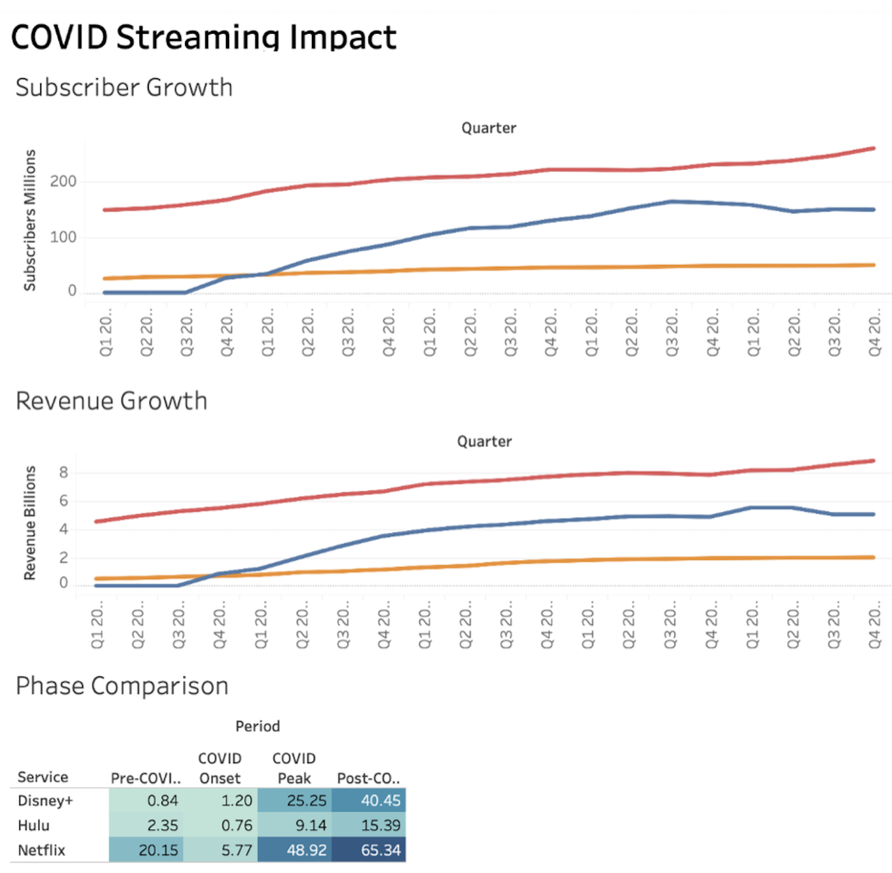

# COVID-19 Impact on the U.S. Streaming Industry (2019–2023)

Data analysis project completed with ACM (April–June 2026) examining how COVID-19 affected subscriber growth and revenue for major streaming services.

## Research Question

How did COVID-19 affect Netflix, Disney+, and Hulu in terms of subscribers and revenue?

## Tools Used

- Tableau (dashboard and visualizations)
- Data: [`streaming_covid_data.csv`](streaming_covid_data.csv), quarterly subscribers and revenue, 2019–2023

## Dashboard

## Key Findings

- All three platforms saw significant subscriber growth during COVID-19. Netflix grew from about 167 million to over 220 million subscribers.
- Subscriber growth slowed after pandemic restrictions eased.
- Revenue kept rising after subscriber growth stabilized, supported by pricing and premium subscription tiers.

## Conclusion

COVID-19 accelerated the shift toward digital entertainment. Subscriber growth eventually leveled off, but revenue kept growing, suggesting that pandemic-driven habits stuck.

## Author

Iris Park, University of California, Riverside
